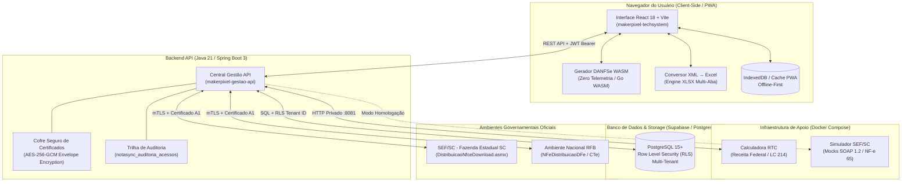

# Central Contábil v3 — by MakerPixel Tech

[](https://mauricio-g-oliveira.github.io/makerpixel-central-contabil/)
[](https://makerpixeltech.com.br)
[](https://github.com/Mauricio-G-Oliveira/makerpixel-gestao-api)
[](https://github.com/Mauricio-G-Oliveira/makerpixel-gestao-api)
[-10b981?style=for-the-badge&logo=nodedotjs)](https://github.com/Mauricio-G-Oliveira/makerpixel-central-contabil)
[](https://mauricio-g-oliveira.github.io/makerpixel-central-contabil/)

> **Plataforma SaaS para escritórios de contabilidade e empresas**: sincronização automatizada de notas fiscais SEF/SC sem intermediadores (NotaSync), auditoria em lote da Reforma Tributária (IBS/CBS - LC 214/2025), gerador de DANFSe WASM no navegador com zero telemetria, conversor universal de XML para Excel e conciliação bancária inteligente.

---

## 🎬 Apresentação Comercial


> 📹 **Vídeo institucional completo em Full HD**: assista diretamente em [`docs/apresentacao-comercial-central-contabil.mp4`](docs/apresentacao-comercial-central-contabil.mp4) ou acesse a [demonstração online](https://mauricio-g-oliveira.github.io/makerpixel-central-contabil/).

---

## 1. Módulos do Sistema

### ⚡ 1. NotaSync — Sincronizador de Documentos Fiscais (SEF/SC & DF-e)
- **Busca Contínua SEF/SC**: download automático de NFC-e (mod. 65) pelo web service oficial para contadores (Boletim Técnico SEF/SC 2026/003, v1.00-1) sem intermediadores ou mensalidades avulsas.
- **Cofre Seguro de Certificados A1**: custódia criptografada em repouso com **AES-256-GCM** e *Envelope Encryption*. O titular é mascarado na interface (`11.***.***/0001-**`).
- **Diagnóstico Amigável**: tradução clara de status da Fazenda com foco no **erro 8002** (*Contabilista não vinculado no SAT*) e link direto de orientação.
- **Detecção de Cancelamentos**: processamento automático de eventos 110111 e deduplicação estrita de chaves de 44 dígitos (Módulo 11).
- **Exportação em Lote**: geração de arquivos ZIP com os XMLs do mês estruturados e exportação de relatórios em planilha.

### 🏛️ 2. Reforma Tributária — Auditor IBS/CBS & Motor RTC (LC 214/2025)
- **Conferência em Lote**: validação item a item de arquivos XML de NF-e, NFC-e e NFS-e contra as regras oficiais da LC 214/2025 e NT 2025.002.
- **Classificação em 5 Níveis**:
  - `OK`: destacado confere com o cálculo oficial (tolerância R$ 0,01);
  - `DIVERGENCIA_VALOR`: diferença numérica entre alíquota destacada e a apurada;
  - `ENQUADRAMENTO_INVALIDO`: CST e cClassTrib incompatíveis ou NCM divergente;
  - `SEM_GRUPO_IBSCBS`: documento emitido sem as tags obrigatórias da reforma;
  - `ERRO_CALCULO`: inconsistência de base ou valores malformados.
- **Comparativo Lado a Lado**: modal interativo exibindo o valor destacado na nota versus o cálculo oficial, memória de cálculo detalhada e fundamentação legal.
- **Calculadora RTC como Serviço**: integração com a calculadora oficial da Receita Federal executando como serviço privado desacoplado em container Docker.
- **Exportação de Divergências**: download de planilha CSV/Excel estruturada para envio direto ao cliente para correção no ERP.

### 📄 3. DANFSe WASM — Emissor de Documento Auxiliar no Navegador
- **Engine WebAssembly**: geração client-side em milissegundos baseada no gerador oficial da Receita Federal (`cmd/danfse-wasm/main.go`).
- **Zero Telemetria e Privacidade Total**: o XML da NFS-e nunca é enviado para a nuvem; o PDF é montado na memória do navegador.
- **Recursos**: pré-visualização com zoom e impressão, suporte a canhoto de recebimento e download avulso em PDF ou em lote compactado em ZIP.

### 📊 4. XML → Excel Universal
- **Conversor Multi-Aba**: processa notas avulsas, pastas compactadas em ZIP ou documentos importados do NotaSync gerando planilhas XLSX com duas abas dedicadas:
  - **Aba 1 (Notas Fiscais)**: dados de cabeçalho, emitente, destinatário, valores totais e tributos destacados (ICMS, ISS, CBS, IBS).
  - **Aba 2 (Itens dos Produtos e Serviços)**: código, descrição, NCM, CFOP, quantidade, valores unitários e tributação detalhada.

### ⚖️ 5. Conciliação Bancária com IA
- **Importação Universal**: compatível com extratos bancários de bancos brasileiros (Banco do Brasil, Itaú, Nubank, Unicred, Sicredi, Caixa, etc.).
- **Regras Inteligentes**: tolerância configurável de datas, baixa automática de tarifas e juros por palavras-chave e conciliação de pagamentos em lote.

### 🏢 6. Departamento Cadastro & Fechamento
- **Alvarás com Leitor de PDFs**: leitura local de documentos com extração de datas e alertas de renovação.
- **Obrigações e Certidões**: monitoramento de CNDs Federal, Estadual, Municipal e CRF do FGTS com alertas preventivos de 7 e 30 dias.
- **Distribuição de Lucros e REINF**: apuração de limites de isenção, retenção de IRRF e transmissão da REINF por competência.

### 🌐 7. Site Público & Funil de Vendas (`makerpixeltech.com.br`)
- Página pública institucional voltada para escritórios contábeis e empresas.
- Apresentação de planos (Essencial, Escritório e Corporativo) e formulário com funil de conversão direta para o WhatsApp comercial da MakerPixel Tech.

---

## 2. Arquitetura do Sistema



---

## 3. Planos e Licenciamento

| Plano | Limite Usuários | Limite Empresas | Armazenamento | Módulos Inclusos |
| :--- | :---: | :---: | :---: | :--- |
| **Essencial** | 2 | 20 | 5 GB | NotaSync, Reforma IBS/CBS, DANFSe, Conciliação, Cadastro |
| **Escritório** *(Mais Escolhido)* | 5 | 60 | 20 GB | Todos os módulos + multi-usuários e prioridade |
| **Corporativo Enterprise** | 15+ | 180+ | 100 GB+ | Recursos ilimitados, implantação guiada e suporte dedicado |

---

## 4. Como Executar Localmente

### Pré-requisitos
- **Node.js** v20+ ou v24+
- **Java** 21 LTS e **Maven** 3.9+
- **Docker** e **Docker Compose**

### 1. Inicializar Infraestrutura e Calculadora RTC
```bash
# Na raiz do projeto
docker compose up -d postgres calculadora-rtc
```

### 2. Inicializar o Backend API (Spring Boot 3)
Em ambiente Unix / macOS:
```bash
cd makerpixel-gestao-api
./mvnw spring-boot:run
```
Em ambiente Windows (PowerShell):
```powershell
cd makerpixel-gestao-api
.\mvnw.cmd spring-boot:run
```
A API iniciará na porta `8080`, aplicando automaticamente as migrations Flyway `V1` a `V8`.

### 3. Inicializar o Frontend (React + Vite)
```bash
cd makerpixel-techsystem
npm install
npm run dev
```
Acesse a aplicação no navegador em `http://localhost:5173`.

### 4. Executar os Testes Automatizados
```bash
cd makerpixel-techsystem
npm test
```
*Resultado esperado: 426 testes passando (100% de aprovação).*

---

## 5. Variáveis de Ambiente

> 🔒 **Atenção**: Esta seção lista exclusivamente os **nomes das variáveis de ambiente** necessárias para a configuração de produção, preservando todo e qualquer segredo.

| Variável | Descrição | Onde Configurar |
| :--- | :--- | :--- |
| `SPRING_DATASOURCE_URL` | String de conexão JDBC com o PostgreSQL / Supabase | Backend API |
| `SPRING_DATASOURCE_USERNAME` | Usuário do banco de dados | Backend API |
| `SPRING_DATASOURCE_PASSWORD` | Senha de acesso ao banco de dados | Backend API |
| `JWT_SECRET` | Chave secreta de assinatura dos tokens JWT | Backend API |
| `ENCRYPTION_MASTER_KEY` | Chave mestra KEK (AES-256) para o cofre de certificados A1 | Backend API |
| `CALCULADORA_RTC_URL` | URL do endpoint da Calculadora RTC (ex: `http://localhost:8081`) | Backend API |
| `SEF_SC_ENDPOINT_URL` | Endpoint oficial do Web Service da SEF/SC | Backend API |
| `VITE_API_URL` | URL base da API REST consumida pelo frontend | Frontend React |
| `SUPABASE_URL` | URL do projeto Supabase | Frontend / Deploy |
| `SUPABASE_ANON_KEY` | Chave anônima pública do Supabase | Frontend / Deploy |

---

## 6. Realidade de Produção vs. Demonstração / Simuladores

Para manter conformidade técnica e transparência:
- **100% Real em Produção**:
  - Buscador NotaSync SEF/SC via web service SOAP oficial;
  - Auditoria IBS/CBS com motor de cálculo LC 214/2025;
  - Gerador DANFSe WASM client-side em PDF;
  - Conversor universal XML para planilhas XLSX;
  - Conciliação bancária de extratos OFX/PDF reais;
  - Banco de dados PostgreSQL com RLS e isolamento multi-tenant.
- **Ambiente de Demonstração / Simulador (GitHub Pages)**:
  - O link de demonstração pública opera em modo sandbox com dados e CNPJs fictícios para exibição comercial sem necessidade de backend conectado.
  - O simulador local (`notasync-simulador`) replica envelopes SOAP para testes de integração contínua sem onerar a Fazenda Estadual.

---

## 7. Documentação Complementar

- [`SEGURANCA.md`](SEGURANCA.md): Diretrizes completas de segurança, cofre A1 e LGPD.
- [`THIRD_PARTY_NOTICES.md`](THIRD_PARTY_NOTICES.md): Atribuições e licenças de componentes de terceiros.
- [`CHANGELOG.md`](CHANGELOG.md): Histórico de versões e release notes da v3.0.0.
- [`docs/roteiro-operacao-admin.md`](docs/roteiro-operacao-admin.md): Manual de operações do administrador.
- [`docs/roteiro-implantacao-cliente.md`](docs/roteiro-implantacao-cliente.md): Guia de onboarding de novo cliente.
- [`docs/roteiro-atualizacao-calculadora-rtc.md`](docs/roteiro-atualizacao-calculadora-rtc.md): Atualização do container RTC.
- [`docs/termo-certificado.md`](docs/termo-certificado.md): Minuta técnica de custódia de certificado digital.
- [`scripts/supabase-schema-central-contabil-v3.sql`](scripts/supabase-schema-central-contabil-v3.sql): Script DDL unificado para deploy no Supabase.

---

## 8. Contato & Suporte Oficial

**MakerPixel Tech — Tecnologia & Automação Contábil**  
- 🌐 **Website**: [makerpixeltech.com.br](https://makerpixeltech.com.br)  
- 📍 **Localização**: Tubarão - Santa Catarina, Brasil  
- 💼 **LinkedIn**: [linkedin.com/in/mauricio-g-oliveira](https://www.linkedin.com/in/mauricio-g-oliveira/)  
- 🐙 **GitHub**: [github.com/Mauricio-G-Oliveira](https://github.com/Mauricio-G-Oliveira)
