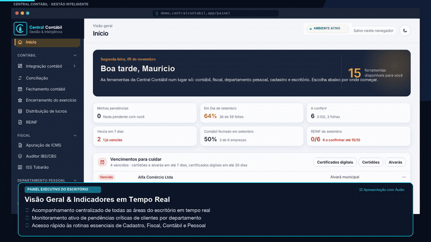
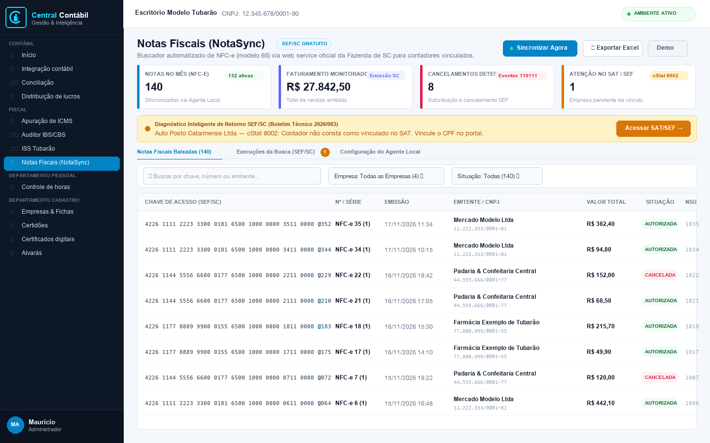
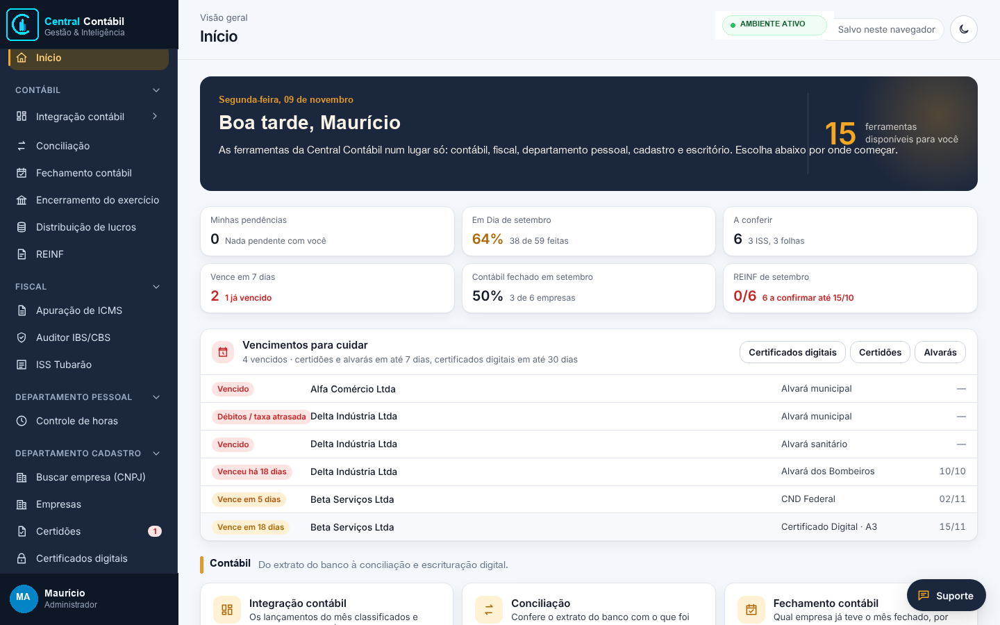
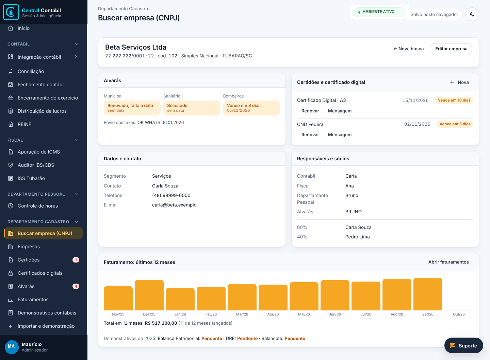
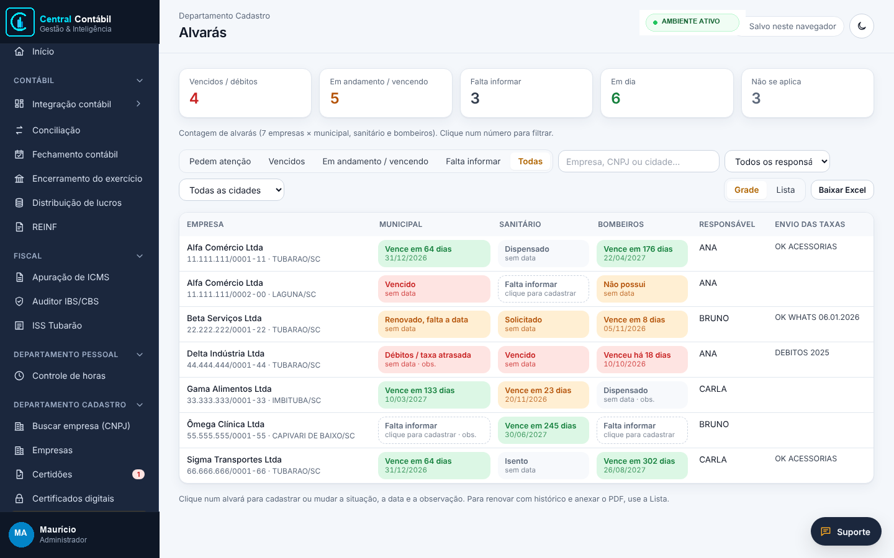
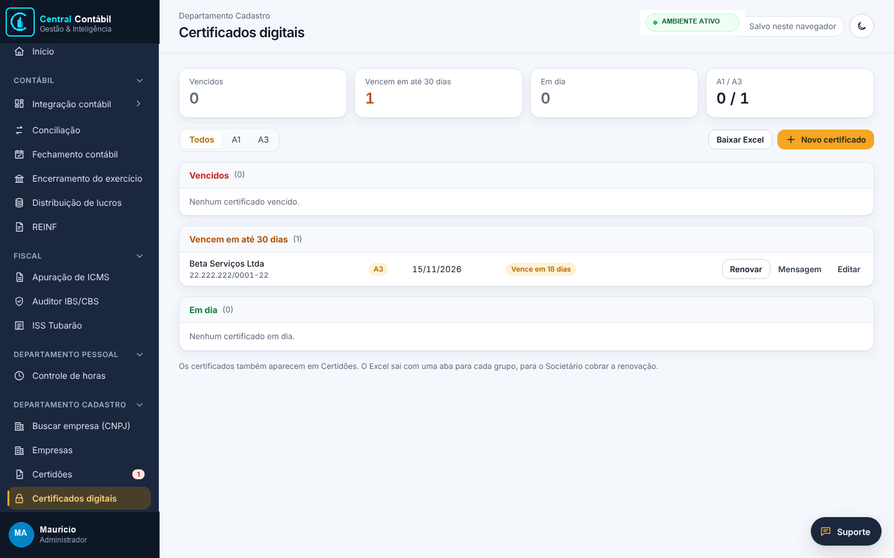
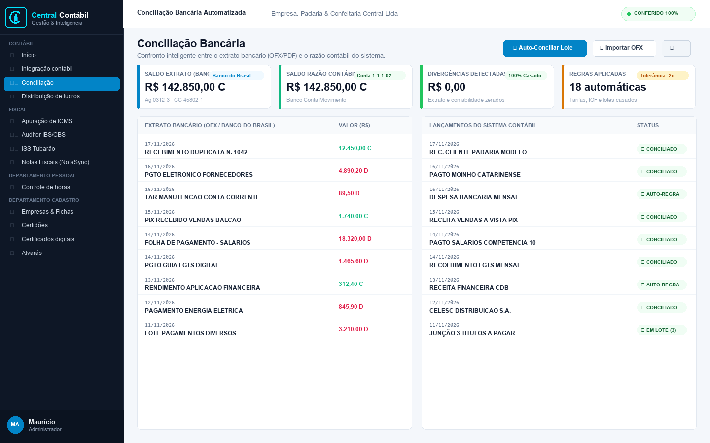
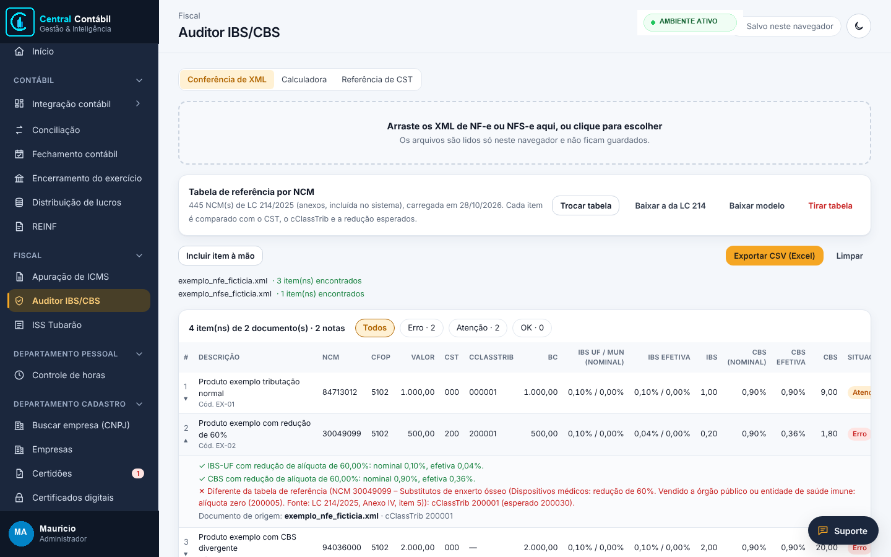
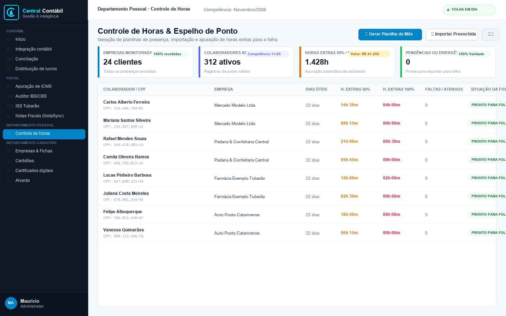
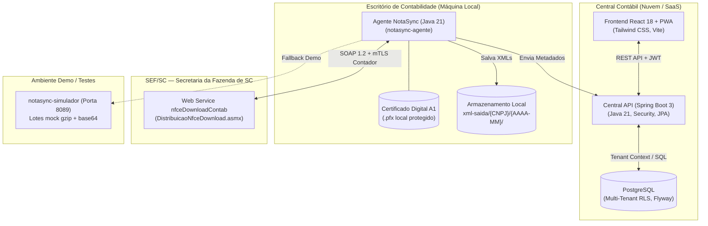

# Central Contábil — by MakerPixel

[](https://mauricio-g-oliveira.github.io/makerpixel-central-contabil/)
[](https://github.com/Mauricio-G-Oliveira/makerpixel-gestao-api)
[](https://github.com/Mauricio-G-Oliveira/makerpixel-gestao-api)
[-10b981?style=for-the-badge&logo=nodedotjs)](https://github.com/Mauricio-G-Oliveira/makerpixel-central-contabil)
[](https://mauricio-g-oliveira.github.io/makerpixel-central-contabil/)

> **Plataforma SaaS para escritórios de contabilidade**: conciliação bancária inteligente, buscador automatizado de NFC-e SEF/SC sem intermediadores (NotaSync), conformidade tributária e gestão operacional multi-tenant.

---

## 🎬 Vídeo de Demonstração



> 📹 **Vídeo comercial completo em Full HD (com narração neural e trilha sonora)**: assista diretamente pelo repositório em [`docs/apresentacao-comercial-central-contabil.mp4`](docs/apresentacao-comercial-central-contabil.mp4) ou acesse a [demonstração online](https://mauricio-g-oliveira.github.io/makerpixel-central-contabil/).

---

## 1. O Problema que Resolve

Escritórios de contabilidade lidam com um volume diário de sistemas fragmentados, retrabalho em planilhas dispersas e tarefas manuais demoradas. Um dos custos mais recorrentes e evitáveis é o pagamento de mensalidades a **intermediadores para baixar arquivos XML de NFC-e**, quando a própria Secretaria da Fazenda (SEF/SC) fornece esse serviço **gratuitamente** para contabilistas vinculados no SAT.

A **Central Contábil** unifica essas rotinas em uma única plataforma SaaS:
- Elimina mensalidades de intermediadores através do módulo **NotaSync** (buscador gratuito direto da SEF/SC via web service para contadores);
- Automatiza a **conciliação bancária** entre extratos (OFX/PDF) e lançamentos contábeis com regras de tolerância e conferência em lote;
- Monitora prazos críticos de certidões, alvarás com leitura inteligente de PDFs e certificados digitais A1/A3 com alertas de 30 dias;
- Distribui a carteira de clientes entre os colaboradores por setor com isolamento multi-tenant e segurança LGPD.

---

## 2. Módulos do Sistema

### ⚡ NotaSync — Buscador Automatizado de NFC-e SEF/SC (Destaque v2)
Busca automatizada de NFC-e (modelo 65) direto da SEF/SC pelo web service oficial para contadores (Boletim Técnico SEF/SC 2026/003, v1.00-1).
- **Agente local (`notasync-agente`)**: guarda o certificado A1 localmente na máquina do escritório, garantindo que a chave privada nunca trafegue pela nuvem. Salva os arquivos físicos em `xml-saida/{CNPJ}/{AAAA-MM}/{chave}.xml` e sincroniza apenas os metadados fiscais com a Central Contábil;
- **Deduplicação estrita**: controle inteligente por chave de acesso de 44 dígitos com validação do dígito verificador via Módulo 11;
- **Detecção de cancelamentos**: processamento de eventos 110111 e 110112 atualizando o status fiscal sem duplicar documentos;
- **Diagnóstico traduzido da SEF**: conversão de cStats técnicos em linguagem prática para o contador, com destaque para o **erro 8002** (*Contabilista não vinculado no SAT*) com link de orientação imediata;
- **Exportação Excel/CSV**: download rápido para cruzamentos fiscais e fechamento do mês.



---

### 📊 Painel Executivo
Visão panorâmica em tempo real de todas as áreas do escritório (Cadastro, Fiscal, Contábil e Pessoal). Apresenta métricas agregadas de clientes, avisos de vencimentos urgentes e atalhos rápidos para as rotinas diárias.



---

### 🏢 Departamento Cadastro
Gestão inteligente da carteira de empresas e cumprimento de obrigações acessórias:
- **Busca unificada**: localização instantânea por CNPJ, código ou razão social com sincronização de sócios (QSA) e dados da Receita Federal;
- **Alvarás com leitor de PDFs**: leitura local de arquivos em PDF com extração automática de CNPJ, emissão e vencimento, decidindo de forma autônoma entre cadastrar novo, renovar ou anexar;
- **Certificados Digitais**: controle dedicado de certificados A1 e A3 com alertas preventivos de 30 dias e botão de disparo rápido de mensagens por WhatsApp/E-mail.

| Ficha Cadastral da Empresa | Alvarás e Leitor de PDF | Certificados Digitais |
| :---: | :---: | :---: |
|  |  |  |

---

### ⚖️ Conciliação Bancária
Confronto automatizado entre extrato bancário (OFX/PDF) e os lançamentos contábeis do cliente:
- Tolerância de datas configurável por cliente (ex.: 2 dias úteis);
- Baixa automática de tarifas bancárias, IOF e rendimentos por palavras-chave cadastradas;
- Junção de pagamentos em lote: vários lançamentos somados que fecham com um único débito no extrato;
- Persistência com trava de concorrência otimista (HTTP 409 em caso de salvamentos simultâneos).



---

### 🛡️ Fiscal & Auditor IBS/CBS
- **Auditor IBS/CBS**: validação de alíquotas, CST e benefícios da Reforma Tributária (LC 214/2025);
- **Apuração de ICMS**: prévia da apuração mensal a partir dos XMLs de NF-e e NFC-e;
- **ISS**: importação de XML do Movimento Econômico com conferência de ISS retido na fonte e retenções federais.



---

### ⏰ Departamento Pessoal — Controle de Horas
- Importação e leitura automática de folhas de presença dos clientes;
- Apuração automatizada de horas extras de 50% e 100%, faltas e atrasos;
- Geração de espelho de ponto pronto para integração com o fechamento da folha de pagamento.



---

## 3. Arquitetura do Sistema



---

## 4. Stack Tecnológica

### Frontend


### Backend API & Agente


---

## 5. Como Rodar o Projeto

### Pré-requisitos
- **Node.js** 20+ ou 24+
- **Java** 21 LTS e **Maven** 3.9+ (ou Docker)
- **PostgreSQL** 15+ (opcional: o frontend opera com banco local IndexedDB no modo demo)

### 1. Clonar os Repositórios
```bash
# Frontend
git clone https://github.com/Mauricio-G-Oliveira/makerpixel-central-contabil.git
cd makerpixel-central-contabil

# Backend
git clone https://github.com/Mauricio-G-Oliveira/makerpixel-gestao-api.git
```

### 2. Rodar o Frontend (React)
```bash
cd makerpixel-central-contabil
npm install
npm run dev
```
Acesse `http://localhost:5173` no navegador.
- **Login Demo**: clique no botão de acesso rápido ou utilize `admin` / senha padrão de demonstração.
- O sistema já carrega com dados fictícios prontos em todas as telas (incluindo 4 empresas e 140 notas fiscais no NotaSync).

### 3. Rodar a API Backend (Spring Boot)
```bash
cd makerpixel-gestao-api
cp .env.example .env
# Iniciar PostgreSQL via Docker Compose
docker-compose up -d postgres

# Executar a API
./mvnw spring-boot:run
```
A API iniciará na porta `8080`, aplicando as migrations Flyway (`V1`, `V2`, `V3__notasync_nfce.sql`).

### 4. Rodar o Simulador SEF/SC (Porta 8089)
O simulador já vem embutido no backend para testes e homologação:
```bash
curl -X POST http://localhost:8080/notasync-simulador/ws/distribuicao/DistribuicaoNfceDownload.asmx
```

---

## 6. Segurança e LGPD

1. **Certificado Digital A1 100% Isolado**: Em conformidade com a LGPD e normas do CFC, o certificado digital do contador e suas chaves privadas **nunca** são transmitidos para o servidor da nuvem. Toda autenticação mútua TLS acontece exclusivamente no agente local (`notasync-agente`).
2. **Dados Fictícios em Demonstrações**: Todos os CNPJs, nomes de empresas, valores e chaves de acesso apresentados em prints, vídeos, seeds e testes são **100% fictícios**, gerados com algoritmos de dígito verificador válidos para reprodução realista.
3. **Isolamento Multi-Tenant**: O banco de dados PostgreSQL utiliza **Row Level Security (RLS)** nativo para segregação completa de dados entre escritórios (`escritorio_id`), impedindo acesso cruzado.

---

## 7. Roadmap

- [x] Módulo NotaSync (NFC-e SEF/SC para contadores);
- [x] Conciliação bancária inteligente com agrupamento em lote e tolerância;
- [x] Auditor tributário IBS/CBS (LC 214/2025);
- [ ] Busca de NF-e (modelo 55) e CT-e (modelo 57) pelo Ambiente Nacional (SVRS / RFB);
- [ ] Integração com o padrão da NFS-e Nacional;
- [ ] Expansão do buscador de NFC-e para outros estados (RS, PR, SP).

---

## 8. Autor

Desenvolvido por **Maurício Goulart de Oliveira**.

- 💼 **LinkedIn**: [linkedin.com/in/mauricio-g-oliveira](https://www.linkedin.com/in/mauricio-g-oliveira/)
- 🌐 **Portfólio**: [mauricio-g-oliveira.github.io](https://mauricio-g-oliveira.github.io/)
- 🐙 **GitHub**: [github.com/Mauricio-G-Oliveira](https://github.com/Mauricio-G-Oliveira)

---

## 🌐 About / Tech Stack (English)

**Central Contábil** is a full-featured SaaS platform designed for Brazilian accounting firms. It streamlines financial and tax workflows by integrating bank reconciliations, tax compliance (Reforma Tributária IBS/CBS, ICMS, ISS), digital certificate expiration tracking, and **NotaSync** — an automated local downloader for NFC-e tax receipts directly from the Santa Catarina State Revenue Service (SEF/SC) SOAP web service with zero third-party fees.

- **Frontend**: React 18, Vite, Tailwind CSS, PWA (Offline-First).
- **Backend**: Java 21, Spring Boot 3, Spring Security (JWT), PostgreSQL with Row Level Security (RLS), Flyway migrations.
- **Security**: Local-first A1 certificate handling with mutual TLS, complete tenant isolation, and strict LGPD compliance.
